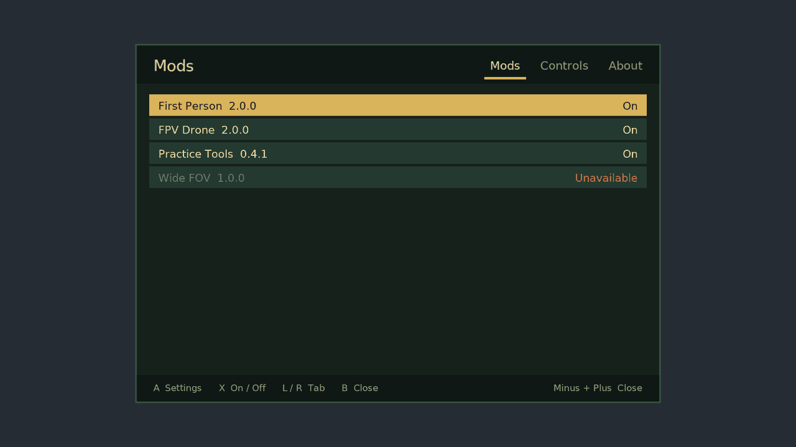
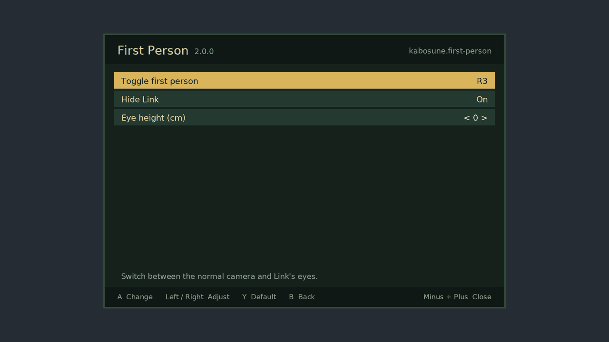
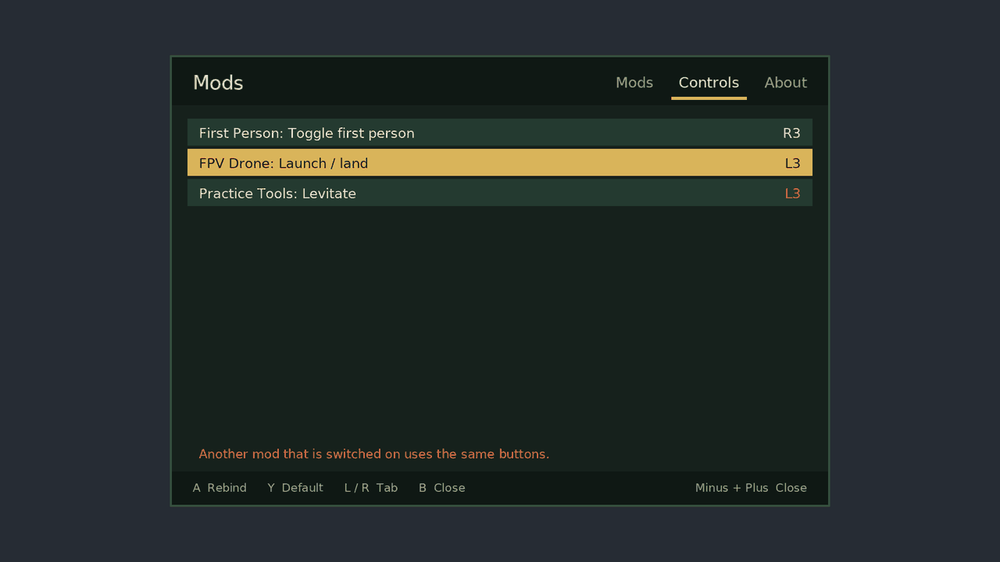

# The Mods menu

**Draft 0.2, 10 November 2026.** Part of [KaeGae](DESIGN.md). The menu's logic and drawing are
portable C in [`menu/`](menu/) and pass their host tests. From API 0.4 the same code is built into
KaeGae Core (`core/menu.c`), drawn with Core's rectangles and built-in font, and a mod declares
its page with `kae_settings`. It opens in the emulated game of the module tests; **it has not run
inside the real game yet**. Inside Core it looks plainer than the screenshots here, which come
from the host renderer's smooth font. Not done yet: saving settings, the keyboard key, and the
reminder on the pause menu.

One screen, called **Mods**, where a player sees every installed mod, switches mods on and off,
changes their settings and rebinds their buttons.



## Where it lives: its own screen, not the game's System menu

The obvious place is a sixth button under Save / Load / Options / Special Actions / Title Screen.
We looked at how that menu is built and decided against it as the way in.

What the game's files show (update v131072):

- The System tab is the layout `PaSystemMenu_00.buil` inside
  `UI/Layout2Archive/Common.Product.100.Nin_Ounce_NVN2.blarc.zs`. It contains exactly five button
  panes, `Pa_Button_00` to `Pa_Button_04`, placed by hand with decoration lines between them. It
  is not a list filled in from data.
- Layout files are a format we haven't seen documented: magic `BFFH`, type
  `Nintendo.Ui.ResModels.LayoutResData`, 157 `.buil` files in that archive. We know of no editor
  for it.
- What each button does is decided in the game's code, per screen class (`UISystemWindowScreen`
  and friends in `RSDB/UIScreen`).

So a sixth button means editing an undocumented layout format, patching the code that handles
five buttons to handle six, and redoing both for every game update and language. That is the
opposite of what the standard is for.

**Decision:**

1. The Mods menu is drawn by KaeGae Core itself, over the game's picture. It needs nothing from
   the game's UI, so it works on every game version.
2. It opens with **− and + pressed together**, anywhere: in play, in the pause menu, on the title
   screen. The combination is rebindable; emulator players also get a keyboard key.
3. So players can find it, Core shows a one-line reminder ("− + : Mods") while the game's pause
   menu is open, on builds where Core can tell that it is. This is drawn by Core, not added to
   the game's layout.
4. A real entry in the game's menus stays possible later as a shortcut to the same screen. The
   Options screen is the better candidate than the System tab: its layout (`SystemOption_00`) is
   a scrolling list built from button templates, which suggests entries are created by code. That
   is a guess from pane names, not something we have traced.

## Why − and +

- They are the game's two menu buttons (map and pause), so "both menu buttons" is easy to remember.
- Mods rarely want them. Stick clicks, the usual choice for overlays, are exactly what gameplay
  mods bind (First Person uses R3, FPV Drone L3).
- A mistake is harmless: pressing only one opens the map or the pause menu.

The cost: Core holds a lone − or + back for 4 controller polls (about 67 ms at 60 per second) to
see whether the other follows. If it doesn't, the press goes to the game, late by that much. A
tap shorter than the wait is replayed so it isn't lost. No other button is delayed.

## What's in it

Three tabs, switched with L / R.

**Mods.** Every installed mod with its version and state. A opens its page, X switches it on or
off. A mod Core had to switch off (wrong game version, a missing symbol, a failed check) shows
"Unavailable" with the reason, and can't be switched on.

**A mod's page.** Its settings, built by Core from what the mod declares. Five kinds:

| Kind | Looks like | Buttons |
|---|---|---|
| Toggle | `Hide Link    On` | A or Left / Right |
| Choice | `Starting mode    < Angle >` | Left / Right |
| Number | `Eye height (cm)    < 4 >`, with a minimum, maximum and step | Left / Right |
| Binding | `Toggle first person    R3` | A, then press the buttons and let go |
| Action | `Reset drone position` | A |

Y puts the selected setting back to its default. A line of help for the selected setting shows
at the bottom.



**Controls.** Every binding of every mod in one list, so the whole button layout is visible at
once. Two mods that are switched on and bound to the same buttons are marked, on this tab and on
their own pages. Rebinding works here too.



**About.** Core's version, the game version and build it found, how many mods are running, and
later the log.

## Rules for mods

- A mod never draws its own settings screen. It declares settings (label, kind, default, range,
  help line) and Core draws them, so every mod's settings look and work the same and a player
  learns the menu once. Custom pages (a warp list, a practice tool) come later as a separate
  feature, with Core still owning the frame, the tabs and the Back button.
- Bindings are declared, never read raw. A mod asks "was my `toggle` action pressed", and Core
  answers from whatever the player bound. That is what makes clash detection and rebinding
  possible for every mod.
- Core saves and restores every setting, per mod ID. A mod doesn't write files.
- While the menu is open the game sees no buttons at all, and none of the buttons used to close
  it leak through as they are released.
- Text is plain English ASCII in this draft. Translations and other scripts need a larger font
  and are planned, not designed.

## Limits in this draft

- **The panel is opaque.** The proven way to draw on this game without Switch 2 shader tools is
  to copy a CPU-drawn picture into the frame (sloperinaGZ's method), and that can't blend with
  what's behind it.
- **The game keeps running behind the menu.** Pausing it properly is possible (the game's pause
  manager, see [sloperina-findings.md](../docs/sloperina-findings.md)) and is left for when Core
  exists.
- **Settings have no stable key yet.** Items are identified by their label, which breaks saved
  settings when a label is reworded. `KaeItem` needs a `key` field before anything is saved.
- **Switching a mod off at run time** means Core stops calling it. Mods that change the game's
  files, or that can't cleanly stop, will need "takes effect after restart"; not designed yet.

## The code

[`menu/kae_menu.h`](menu/kae_menu.h) and [`menu/kae_menu.c`](menu/kae_menu.c): the menu's state,
the input handling (opening combination, navigation, rebinding, what the game is allowed to see)
and a small CPU renderer with a built-in font. No dependencies, not even the C library, so the
same file can be compiled into Core.

```
cd api/menu
cc -O1 -Wall -I../include -o test_menu test_menu.c kae_menu.c
./test_menu
```

`test_menu` runs 45 checks (the opening combination's timing, replayed taps, hidden input,
navigation, clamping, defaults, rebinding, clash detection, closing) and writes the three
screenshots on this page as `.ppm` files. The mods in the screenshots are made-up test data.

The font is DejaVu Sans, baked into `font.h` by `genfont.py`; its licence is in
`menu/FONT-LICENSE.txt`.
